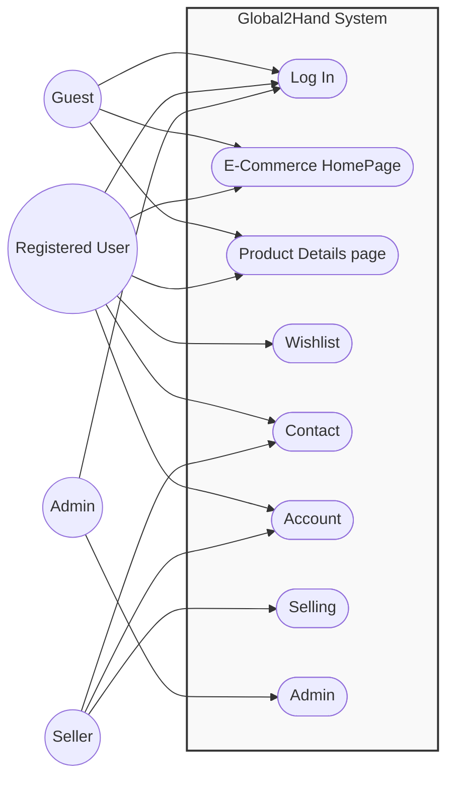
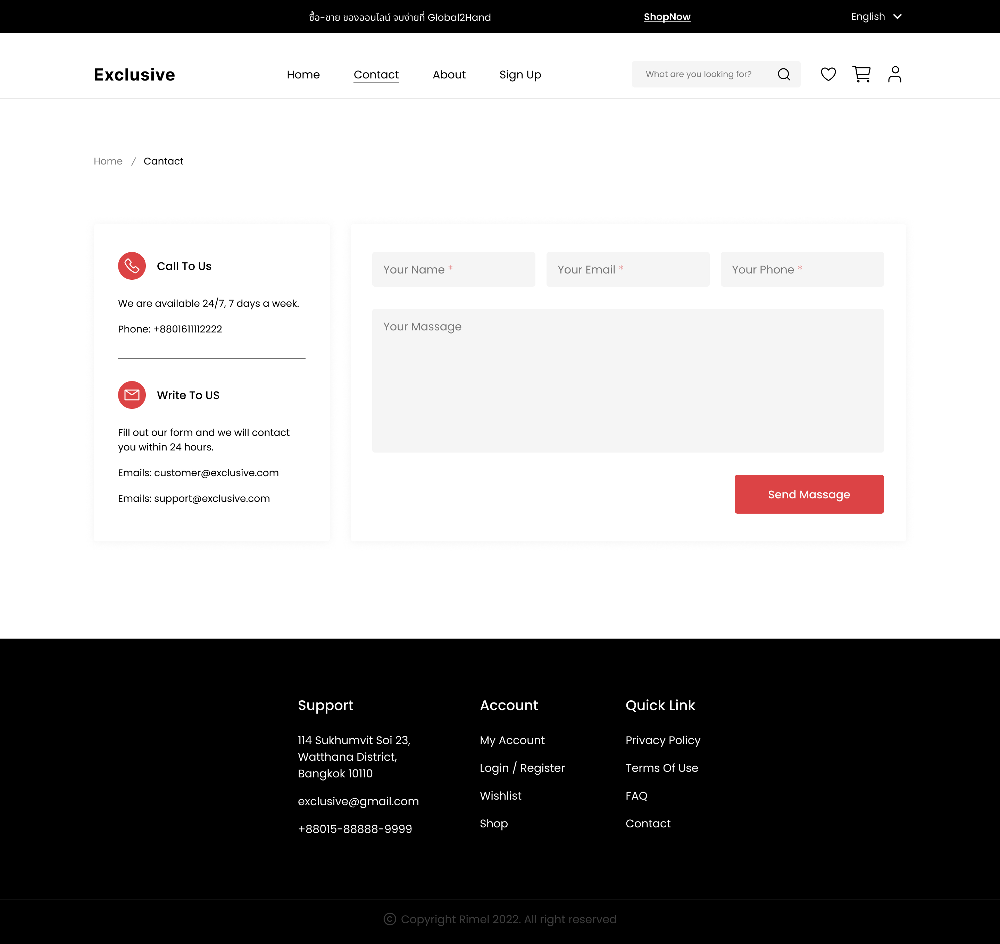
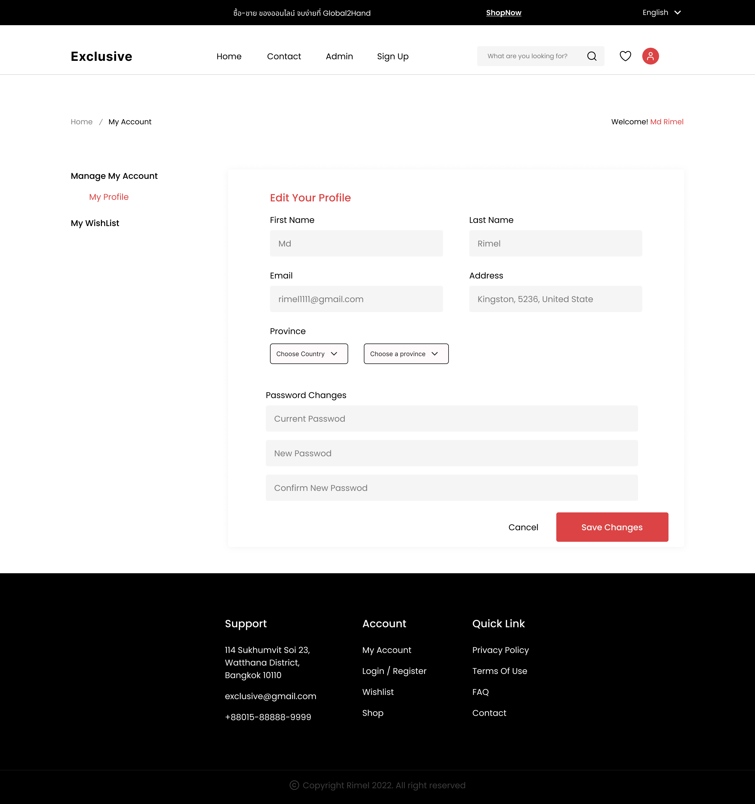
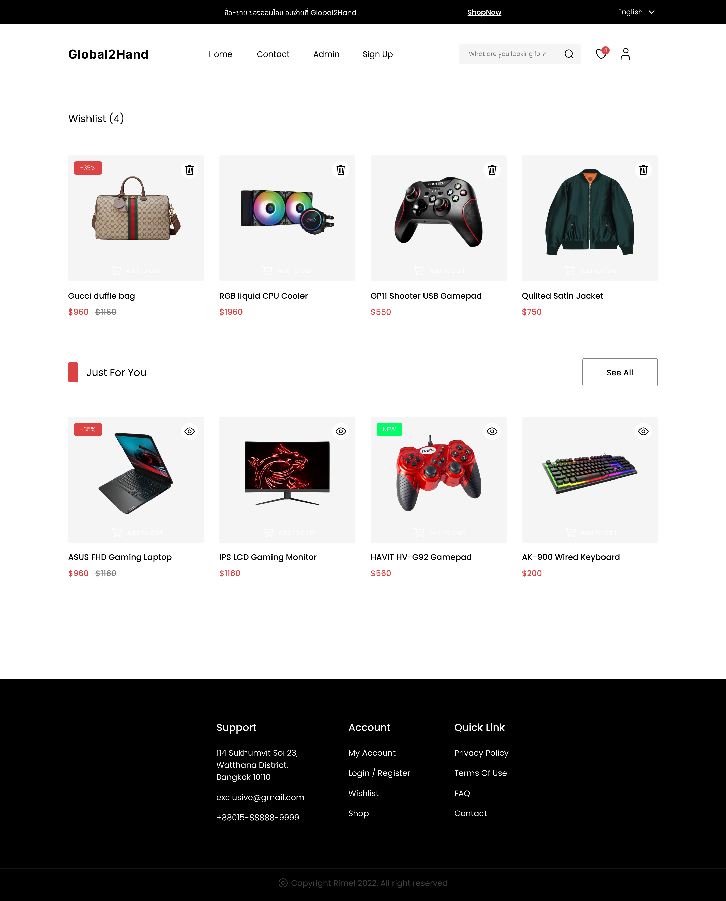
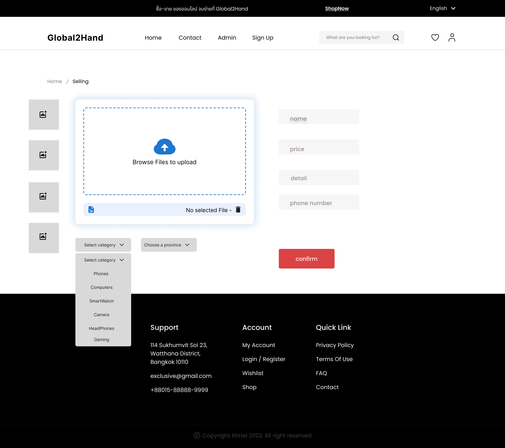
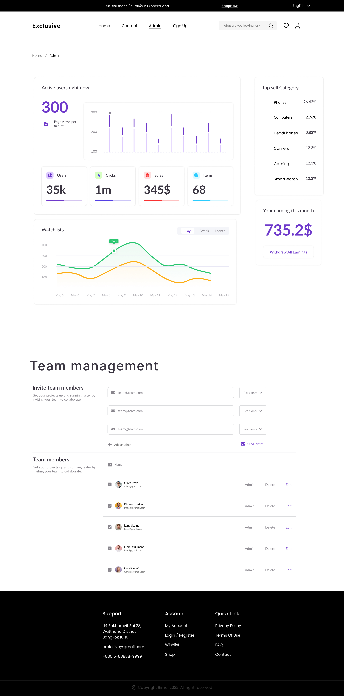

#  Global2Hand

# สมาชิกกลุ่ม 
- นายกฤตตฤณ บุญสู่ 67102010157
- นายณัฐพล สวนใหญ่  67102010162
- นายวรศักดิ์ แสนกล้า  67102010527

# 1. ที่มาของปัญหาและความสำคัญ

ปัจจุบันมีสินค้ามือสองจำนวนมากที่ยังสามารถใช้งานได้ แต่ไม่ได้ถูกนำกลับมาใช้ประโยชน์อย่างเต็มที่ เนื่องจากขาดแพลตฟอร์มที่ใช้งานง่ายและเข้าถึงได้สะดวกสำหรับการซื้อขายหรือแลกเปลี่ยนสินค้าระหว่างบุคคลทั่วไป
Global2Hand ถูกพัฒนาขึ้นเพื่อเป็นศูนย์กลางในการเชื่อมต่อผู้ที่ต้องการขายสินค้ามือสองกับผู้ที่กำลังมองหาสินค้าเหล่านั้น โดยช่วยลดความยุ่งยากในการลงประกาศ และเปิดโอกาสให้เกิดการใช้ทรัพยากรอย่างคุ้มค่า

# 2. จุดประสงค์ของโครงการ และประโยชน์ที่คาดว่าจะได้รับ

จุดประสงค์
- เพื่อพัฒนาเว็บแอปพลิเคชันที่สนับสนุนการซื้อขายสินค้ามือสองอย่างง่ายและสะดวก
- เพื่อเปิดโอกาสให้ผู้ใช้งานสามารถลงประกาศขายสินค้าได้ฟรีและไม่ซับซ้อน
- เพื่อเป็นพื้นที่กลางในการติดต่อระหว่างผู้ซื้อและผู้ขาย

ประโยชน์ที่คาดว่าจะได้รับ
- ผู้ใช้งานสามารถขายและค้นหาสินค้ามือสองได้ง่ายขึ้น
- ลดปัญหาสินค้าที่ไม่ได้ใช้งานและช่วยส่งเสริมการใช้ทรัพยากรอย่างคุ้มค่า
- ผู้ใช้ใหม่สามารถเข้าใจและใช้งานระบบได้ทันที

# 3. ขอบเขตของโครงการ (Project Scope)

สิ่งที่ระบบทำ (In-Scope)
- สมัครสมาชิกและเข้าสู่ระบบเพื่อยืนยันตัวตน
- ลงประกาศขายสินค้ามือสองได้ทุกประเภท
- แก้ไข ลบ หรือเปลี่ยนสถานะสินค้าเป็น "ขายแล้ว"
- ค้นหาสินค้าตามชื่อหรือหมวดหมู่
- ดูรายละเอียดสินค้าและข้อมูลการติดต่อผู้ขาย
- บันทึกสินค้าที่สนใจ
  
สิ่งที่ระบบไม่ทำ (Out-of-Scope)
- ระบบชำระเงินออนไลน์ภายในแพลตฟอร์ม
- ระบบจัดส่งสินค้า
- การคิดค่าธรรมเนียมจากผู้ใช้งาน

#  4. Functional Requirements
- ระบบต้องให้ผู้ใช้สามารถสมัครสมาชิกและเข้าสู่ระบบได้ เพื่อยืนยันตัวตนก่อนใช้งานฟังก์ชันต่าง ๆ
- ผู้ใช้ต้องสามารถสร้างประกาศขายสินค้าได้โดยกรอกข้อมูลที่จำเป็นเพียงไม่กี่รายการ เช่น ชื่อสินค้า ราคา รายละเอียด และรูปภาพ เพื่อให้การลงขายไม่ซับซ้อน
- ระบบต้องรองรับการลงขายสินค้ามือสองได้ทุกประเภท ไม่จำกัดเฉพาะหมวดหมู่ใดหมวดหมู่หนึ่ง
- ผู้ใช้ต้องสามารถแก้ไขข้อมูล ลบประกาศ หรือเปลี่ยนสถานะของสินค้าของตนเองเป็น “ขายแล้ว” ได้
- ระบบต้องมีฟังก์ชันค้นหาสินค้า โดยผู้ใช้สามารถค้นหาจากชื่อสินค้า หรือเลือกดูตามหมวดหมู่ได้
- ระบบต้องแสดงข้อมูลการติดต่อของผู้ขาย เพื่อให้ผู้ซื้อสามารถติดต่อและตกลงซื้อขายกันได้โดยตรงนอกแพลตฟอร์ม

# 5. Non-Functional Requirements

- ระบบต้องถูกออกแบบให้ใช้งานง่าย เมนูไม่ซับซ้อน และปุ่มต่างๆ ชัดเจน
- ผู้ใช้ใหม่ต้องสามารถเข้าใจและใช้งานระบบได้ทันทีโดยไม่ต้องมีคำอธิบายเพิ่มเติม
- ระบบต้องรองรับการใช้งานผ่าน Web Browser เพื่อให้เข้าถึงได้สะดวกจากอุปกรณ์ต่าง ๆ
- ระบบต้องไม่มีค่าธรรมเนียมในการลงประกาศขายสินค้า เพื่อจูงใจให้ผู้ใช้งานนำสินค้ามาลงขายมากขึ้น
- อย่างไรก็ตาม ระบบอาจมี ทางเลือกเสริม (Optional Feature) สำหรับผู้ใช้งานที่ต้องการเพิ่มการมองเห็นของสินค้า โดยผู้ขายสามารถเลือกชำระค่าบริการเพิ่มเติมจำนวน 20 บาท เพื่อให้สินค้าของตนแสดงในตำแหน่ง รายการแนะนำ (Recommended Items) หรือแสดงเป็นรายการบนสุดของหน้าเว็บเป็นระยะเวลาที่กำหนด

# 6. Use case diagram 

# 7. อธิบายกระบวนการทำงาน (Process, Methods, Tools)
Process
- โครงการ Global2Hand  สามารถพัฒนาระบบได้อย่างเป็นขั้นตอน และปรับปรุงตามข้อเสนอแนะได้อย่างต่อเนื่อง โดยมีลำดับกระบวนการทำงานดังนี้
- เริ่มจากการวิเคราะห์ปัญหาและเก็บความต้องการของผู้ใช้งาน (Requirement Analysis) ผ่านการพูดคุยและสัมภาษณ์ เพื่อทำความเข้าใจและความต้องการที่แท้จริง
จากนั้นนำข้อมูลที่ได้มาสรุปเป็น Requirement specification และแปลงเป็น User Story เพื่อใช้วางแผนการพัฒนา
- ในขั้นตอนการวางแผนงาน เราแบ่งงานออกเป็นรอบการพัฒนา (Sprint) โดยใน Sprint แรกจะเน้นการจัดทำเอกสาร requirement และการออกแบบระบบเบื้องต้น
เมื่อเข้าสู่ขั้นตอนการพัฒนา จะพัฒนาเว็บแอปพลิเคชันด้วย Node.js ตามฟีเจอร์ที่กำหนดไว้ในแต่ละ Sprint
- หลังจากพัฒนาเสร็จในแต่ละรอบ จะมีการทดสอบการทำงานของระบบ และประชุมสรุปผลการทำงาน (Retrospective) เพื่อทบทวนสิ่งที่ทำได้ดี ปัญหาที่พบ และแนวทางปรับปรุงใน Sprint ถัดไป

Tools

- ในการพัฒนาโครงการ Global2Hand ทีมงานใช้เครื่องมือดังต่อไปนี้
 
- Node.js ใช้เป็นฝั่ง Backend สำหรับพัฒนาเว็บแอปพลิเคชันและจัดการ logic ของระบบ

- Express.js ใช้สำหรับสร้าง API และจัดการ routing ของระบบ

- HTML, CSS, JavaScript ใช้สำหรับพัฒนา Frontend ของเว็บไซต์

- GitHub ใช้ในการจัดเก็บ source code การทำงานร่วมกัน และการจัดการ Issue และ Milestone

- Visual Studio Code ใช้เป็นเครื่องมือหลักในการเขียนโปรแกรม

- Mermaid ใช้สำหรับออกแบบ Use Case Diagram 

- YouTube ใช้สำหรับบันทึกวิดีโอการสัมภาษณ์ผู้ใช้งานและการประชุม Retrospective
  
- Figma ในการออกแบบ

# 8. เขียนสรุปขั้นตอนการทำ requirement และ video interview และ video Retrospective 
- ผู้กำหนดความต้องการต้องการให้ระบบ Global2Hand เป็นแพลตฟอร์มซื้อขายสินค้ามือสองที่ใช้งานง่าย ผู้ใช้งานสามารถลงขายสินค้าได้โดยไม่ซับซ้อน รองรับการลงขายสินค้าทุกประเภท และไม่มีค่าธรรมเนียมในการลงประกาศ

- หน้าเว็บแอปควรออกแบบให้เข้าใจง่าย ผู้ใช้ใหม่สามารถใช้งานได้ทันที ระบบต้องมีฟังก์ชันค้นหาสินค้าตามชื่อหรือหมวดหมู่ และแสดงข้อมูลการติดต่อของผู้ขายเพื่อให้ผู้ซื้อสามารถติดต่อกันได้โดยตรง
  
# video interview
- https://youtu.be/bYKV8D49juY

# Retrospective Video (After Getting Requirements)
- https://youtu.be/LsVN2AMTaVE

# 9. Retrospective Meeting Summary
สรุปการประชุม

- ทางเราได้ทบทวนผลการดำเนินงานในช่วงที่ผ่านมา พบว่าโดยภาพรวมสามารถออกแบบและกำหนด Requirement ของระบบได้ครบถ้วนตามความต้องการที่ได้รับ และสามารถวางแนวทางการพัฒนาเว็บไซต์ได้ชัดเจน

สิ่งที่ทำได้ดี:
- เราสามารถทำความเข้าใจความต้องการของระบบได้ตรงกัน และสามารถแปลง Requirement เป็น User Story ได้อย่างชัดเจน ฟังก์ชันหลักของระบบมีความครบถ้วนและสอดคล้องกับปัญหาที่ต้องการแก้ไข

ปัญหาที่พบ:
- ระบบถูกออกแบบให้ผู้ใช้งานสามารถลงประกาศขายสินค้าได้ฟรีทั้งหมด ซึ่งอาจทำให้ไม่มีรายรับสำหรับการดูแลและพัฒนาระบบในระยะยาว

แนวทางปรับปรุง:
- เพิ่มทางเลือกเสริมสำหรับผู้ใช้งาน เช่น การชำระค่าบริการเพิ่มเติมเพื่อให้สินค้าขึ้นเป็นรายการแนะนำหรือแสดงในตำแหน่งบนสุดของหน้าเว็บ โดยยังคงให้การลงประกาศขายแบบปกติสามารถใช้งานได้ฟรี

# 10. Show screenshot and explanation of the following page
- Product backlog: Work items ที่มีการใช้ Issue
    

  

- print backlog: มีการกำหนดเวลาและวางแผน issue สำหรับ Milestone
   

  
  

# 11. ระยะเวลาดำเนินโครงการ

โครงการแบ่งการพัฒนาออกเป็น 4 Sprint 

Sprint 1: Requirement & Planning

Sprint 2: System Design & Basic Setup

Sprint 3: Core Features Development

Sprint 4: Enhancement & Final Review

# 12. UI DESIGN (Figma)
การออกแบบส่วนติดต่อผู้ใช้ (User Interface: UI) ของระบบ Global2Hand ได้จัดทำขึ้นโดยใช้โปรแกรม Figma เพื่อใช้ในการวางโครงสร้างหน้าจอ (Layout) และกำหนดรูปแบบการใช้งานก่อนเข้าสู่ขั้นตอนการพัฒนา โดยมีวัตถุประสงค์เพื่อให้ระบบใช้งานง่าย มีความชัดเจน สวยงาม และมีความสอดคล้องกันในทุกหน้า

หน้าจอที่ได้ออกแบบประกอบด้วย

### หน้าเข้าสู่ระบบ (Login Page)

### หน้าหลักของระบบ (Home Page)

### หน้าติดต่อ (Contact Page)

### หน้าโปรไฟล์ผู้ใช้ (Account Page)

### หน้ารายละเอียดสินค้า (Product Details Page)

### หน้าสิ่งที่ต้องการซื้อ (Wishlist Page)

### หน้าสำหรับผู้ขายสินค้า (Selling Page)

### หน้าสำหรับผู้ดูแลระบบ (Admin Page)

figma UI design link 
[https://www.figma.com/design/0vFIj9tluDLwFzyI5hpuCq/Global2hand?node-id=0-1&p=f&t=EcHtSe3hhdJEz9ur-0](https://www.figma.com/design/hEz2xKAabJg9pLLRPwhMSA/Global2Hand2?node-id=1-3&t=o48RQZ0FqdgRkcGF-1)

# Retrospective Video — Phase 2  
- https://youtu.be/536lARsl9nU

# Retrospective Video — Phase 3
- https://www.youtube.com/watch?v=MFsiYgu7DpQ&feature=youtu.be

# Retrospective Video — Phase 4
- https://www.youtube.com/watch?v=Li1XwceUShI

