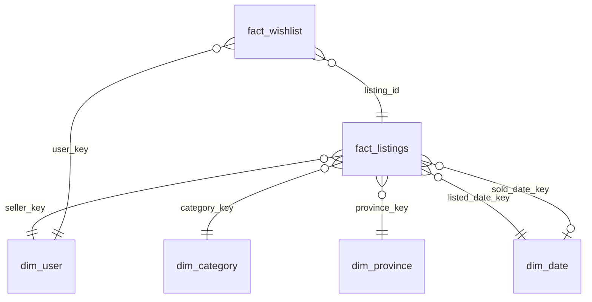
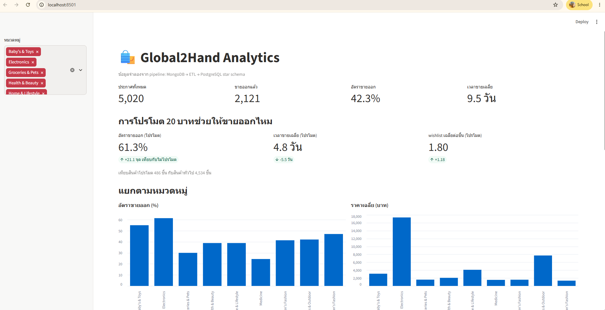

# Global2Hand Analytics Pipeline

An analytics layer for [Global2Hand](../README.md), a second-hand marketplace web app.
It moves operational data from the app's **MongoDB** database into a **PostgreSQL star-schema
warehouse** with an **incremental ETL**, then answers business questions in a **Streamlit** dashboard.

> **Note:** All data is synthetic, generated by `seed_mongo.py` using the same document structure
> as the app's Mongoose models (`models/`). The "promoted listings sell faster" pattern is built
> into the generator on purpose, so the results show that the pipeline *can measure* the effect,
> not that the effect exists for real users.

## Architecture

```
MongoDB (app database)          ETL (Python)                     PostgreSQL warehouse        Dashboard
users / items / categories ──►  extract changed items      ──►   star schema           ──►   Streamlit
                                (updatedAt >= watermark)         fact_listings
                                transform documents → rows       fact_wishlist
                                upsert + update watermark        dim_category / dim_user
                                                                 dim_province / dim_date
         └──────────────── both databases run in Docker Compose ────────────────┘
```

## Data Model



- **fact_listings** — one row per listing (accumulating snapshot): price, sold flag, promoted flag, days to sell. The row is updated when the listing's status changes.
- **fact_wishlist** — one row per (user, listing) pair, flattened from the `wishlist` array inside each user document.
- **dim_date** — one row per day, so reports can group by week, month or weekend without date math.

## Load Strategy

| Table | Strategy | Reason |
|---|---|---|
| `fact_listings` | **Incremental** — only items with `updatedAt >= last watermark` | Listings grow continuously; reloading everything does not scale |
| Dimensions | Full upsert every run | Small tables |
| `fact_wishlist` | Full refresh (truncate + insert) | Wishlists are arrays with no change timestamp |

Every run executes inside **one transaction** and every load is an **upsert**, so the pipeline is
**idempotent**: re-running it, or re-reading rows at the watermark boundary, never creates duplicates.

## Dashboard

Answers questions such as:
- Does the paid 20 THB "recommended listing" feature improve sell-through rate and time to sell?
- Which categories sell best, and at what average price?
- Which provinces have the most listings?
- How many new listings arrive each week?



## Tech Stack

Python (pymongo, psycopg2, pandas) · MongoDB · PostgreSQL · Docker Compose · Streamlit · Linux (Ubuntu on WSL2)

## How to Run

```bash
cd analytics
docker compose up -d                                   # MongoDB :27017, PostgreSQL :5433
python3 -m venv .venv && source .venv/bin/activate
pip install -r requirements.txt

python seed_mongo.py                                   # 500 users, 5,000 listings
docker exec -i g2h-warehouse psql -U analytics -d warehouse < sql/warehouse_schema.sql
python etl_warehouse.py                                # first run: full load

python simulate_activity.py                            # 50 items sold, 20 new listings
python etl_warehouse.py                                # incremental: ~70 rows only

streamlit run dashboard.py                             # http://localhost:8501
```

## Files

| File | Purpose |
|---|---|
| `docker-compose.yml` | MongoDB + PostgreSQL warehouse containers |
| `seed_mongo.py` | Generates synthetic marketplace data (reproducible, fixed random seed) |
| `sql/warehouse_schema.sql` | Star schema DDL and `dim_date` population |
| `etl_warehouse.py` | Incremental ETL from MongoDB to PostgreSQL |
| `simulate_activity.py` | Simulates new sales and listings to demonstrate incremental loading |
| `dashboard.py` | Streamlit dashboard |

## Next Steps

- Schedule the ETL with Apache Airflow
- Add data quality checks (e.g. no negative prices, every fact row has valid keys)
- Model transformations with dbt
